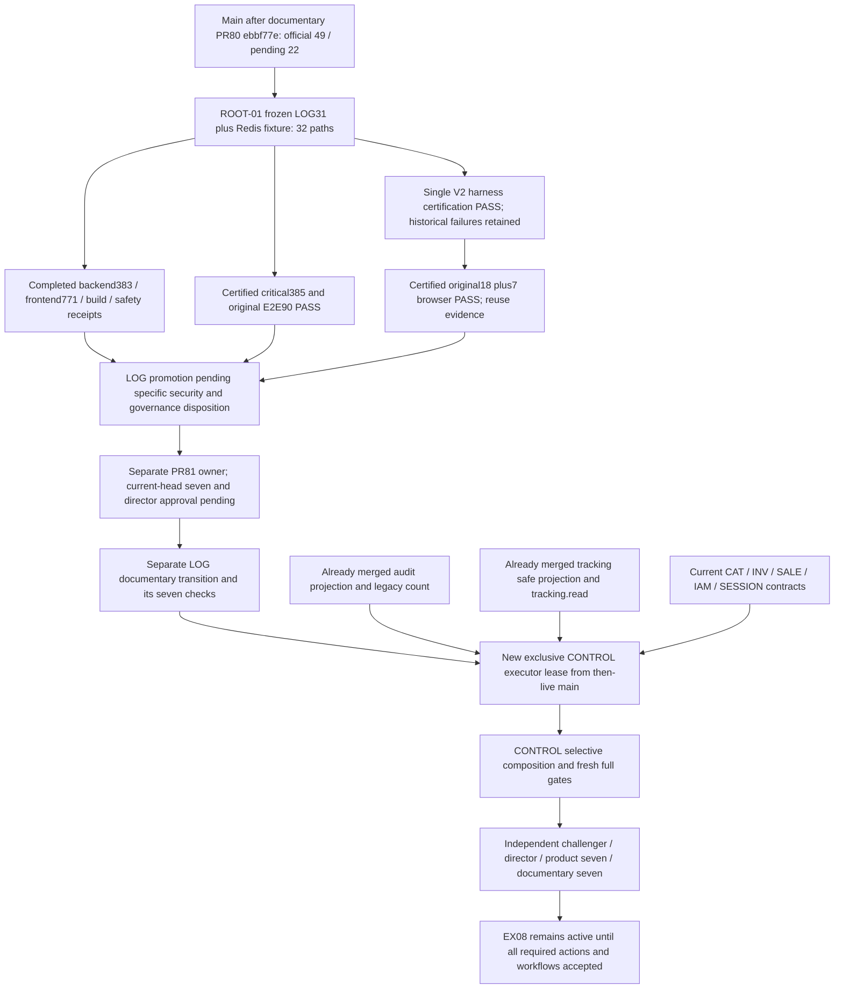

# ROOT-02 dependency graph and bounded integration order

Current reconciliation after authorized PR80: main `ebbf77ed04fd03fdc2529628f54214acda514888`; LOG QA_LOCAL_PASS / PROMOTION_PENDING on sealed source1302. Historical snapshot below remains evidence; current status and exact certificate hashes are in the QA matrix. Original QA leases released; separate PR81 ownership and promotion gates remain. No certified local QA is rerun.

Evidence snapshot: 2026-10-19 18:02:05 UTC, main `aa619fc9f9b2ff6fd1a3cdf69fa19c42a69774d5`. Read with [QA matrix](../INTEGRATION/QA_MATRIX.md). Static evidence lives at `/home/wundah/distritoolsjl-root02-evidence-20261019/B/RECONCILIATION_STATIC_SNAPSHOT.json`. This is a proposed integration map, not a lease, test result, merge authorization or action certification.

LOG and CONTROL acceptance cannot be inferred from documentary consolidation. Production release also depends on the independent security, governance, business/provider, legal and cutover fences in STATE. Director-authorized PR79 is merged at a5ef8f0 with LEGAL24 business content `USER_CONTENT_APPROVED2026-10-19`; counsel review, missing corporate data/signatures, effectiveness and publication are still blocked. DRAFT/NO_PUBLICAR and unresolved B01–B13/T01–T08 remain.

## What current main already supplies

| Dependency | Live source evidence / disposition | Integration rule |
|---|---|---|
| Audit projection permission boundary | `get-admin-dashboard.use-case.ts` checks `audit.read`, emits `recentActivity.auditAccessStatus`; `get-admin-reports.use-case.ts` checks `audit.read`, emits `reports.audit.accessStatus`. Existing unit/critical boundary tests are present. | `PASS` source dependency exists. Exclude old two-file shadow overlays from CONTROL; consume current fields and retest denial/grant/revoke. Source existence is not new browser acceptance. |
| Legacy aggregate audit count | Current `EX-08.CONTROL-legacy-audit-count-closure.md` records separately merged bounded correction and tests. | `PASS` integrated dependency. Do not reintroduce old controller/counter preimages or count additional actions. |
| Safe shipment events | Current `getShipmentEvents` in admin operations requires `tracking.read`, selects only id/status/occurredAt, takes latest100 ordered occurredAt DESC/id DESC. Existing raw tracking unit/critical tests remain. | `PASS` integrated boundary. Preserve exact no-PII projection and permission; no provider activation or old broad event payload. |
| Tracking navigation alignment | Current canonical main still lists rastreo navigation `shipping.read`; LOG31 candidate already changes it and tests toward `tracking.read`. | Compose from LOG-accepted main. CONTROL must retain that alignment, and review any local navigation map against current targets; never restore shipping-only tracking authority. |
| Session / IAM | Current main has later session recovery, effective permission catalog and IAM fixture changes; LOG31 has only the composed await seam in its new test and preserves current source. | Preserve all current auth/RBAC/2FA behavior and IAM fixture lines. Revoke permissions using the same JWT in new browser acceptance. No IAM rollback or policy rewrite. |
| CAT / INV / SALE targets | Current CAT `INCOMPLETE`, orders detail/list and inventory/report contracts supply real destinations. | Test links/filter round trips against current screens; no copied old feature tree or fabricated endpoint. |

## CONTROL source comparison, not whole-branch import

Old candidate: `/home/wundah/distritoolsjl-ex08-control-oct11`, branch `ui/ex08-control-dashboard-reports-oct11`, HEAD `42d4d4b23394fe9fcad85fde23d24c4d3b03d31d`, no upstream at original delivery. It is 20 commits behind aa619fc. Its dirty scope has exactly 14 paths: four modified and ten new. All four modified preimages equal current main bytes; none of the ten new paths exists on current main. B recorded each candidate SHA256 and comparison in its external snapshot.

That narrow preimage compatibility does not establish runtime compatibility. A whole-tree diff against main includes later main product deletions/reversions because the candidate's base is old. Import only rehashed assigned postimages, then compose current-only seams; never checkout/reset/copy the old entire branch.

| Unique seam | Exact candidate paths | Contract dependency / bounded acceptance |
|---|---|---|
| Dashboard read presentation and action destinations | `frontend/src/components/admin/AdminDashboard.tsx` | Current dashboard schema, explicit financial/audit denials, real ranges, COD once, current effective session links. No backend KPI-policy rewrite. |
| Reports URL/query/view | `frontend/src/app/admin/reportes/page.tsx`; `frontend/src/components/admin/AdminReports.tsx`; `frontend/src/features/admin/control/readers.ts`; `contracts.ts`; `presentation.ts` | Real summary route, today/7d/30d/month, order/payment/shipping/module filters, tabs and 20-row presentation pages over bounded samples; no new server pagination. Audit denial must not become empty-success or zero. |
| Navigation and responsive styling | `frontend/src/features/admin/control/Navigation.tsx`; `control.module.css` | Session-aware target permissions, CAT pair `catalog.read`+`products.read`, current shipment/tracking separation, no new broad role/permission gates. Width320/375/768/1024/1440 and keyboard focus proof. |
| Export BFF and download UX | `frontend/src/app/api/admin/reports/export/route.ts`; `frontend/src/features/admin/control/ExportLink.tsx` | GET BFF proxies POST backend, private/no-store/nosniff, cross-site rejection, valid bounded MIME/bytes and sanitized failure; current server remains authority. `audit.export` stays independent of `audit.read`. |
| Local contract regression tests | `frontend/src/tests/ex08-control-views.test.tsx`; `frontend/src/tests/ex08-control-export.test.ts`; `tests/critical/ex08-control-admin.e2e.test.ts` | Six real Nest/SQL groups in old candidate are prospective inputs. New full suite must cover current merged audit/raw-tracking/session contracts and preserve original tests. |
| Historical delivery report | `docs/orchestration/runs/EX-08.CONTROL-dashboard-reports-final.md` | Preserve old head/shadow/gate qualifications. Replace stale next-step claims only through reviewed documentary updates; do not present historical PASS as current acceptance. |

Candidate `Navigation.tsx` maps envios to `shipping.read`, has no rastreo mapping, and disables destinations with unknown required permissions. Future alignment must explicitly cover actual tracking links and regressions under the approved current catalog; do not invent a wider navigation rewrite. Existing links to shipment list/detail still need `shipping.read` as their destination requires it.

The canonical CONTENT closure's term “CONTROL16” is a preserved planned composition, not a verified 16-path manifest in this review. B independently verified original CONTROL14 only. A future executor must locate/re-hash the authoritative preserved CONTROL16 manifest and its two extra paths before transfer; otherwise freeze a new explicit allowlist with director disposition. The known required seam is tracking.read alignment; a scope count alone cannot authorize unknown postimages.

## Proposed bounded future PR units and exact next owners

| Unit | Dependency / scope fence | Next owner and required disposition |
|---|---|---|
| ROOT-01 local QA remediation | Existing LOG31 plus one test fixture; no product auth/parser/provider changes. | Original QA completed and all three leases released. Reuse sealed1302-source critical/E2E/browser PASS; ROOT-01 remains evidence custodian and the separate PR81 executor retains its branch. ROOT-02 does not duplicate QA or infer promotion. |
| LOG product integration | Accepted local candidate only after complete critical/E2E/browser/security evidence. | PR81 is open under a separate executor. Reconcile its current HEAD against live main and obtain applicable LOG-specific security/governance disposition and explicit director merge approval. Do not split/copy its source or rerun already certified local QA. Whether fixture remains with LOG or gets an independent QA PR needs explicit frozen scope disposition and appropriate fresh gates. |
| LOG documentary closure | Product merge accepted; separate run/user impact/STATE/action-matrix changes and independent exact seven. | Director/orchestrator. Grant only action rows supported by actual bounded acceptance, retain provider/business pending rows; no blanket LOG closure based on local PASS. |
| CONTROL product composition | Then-current main after LOG closure, rehashed explicit CONTROL manifest; no backend audit/legacy/raw tracking reimplementation. | Director/orchestrator assigns a new named exclusive CONTROL executor and independent browser/challenger owners. Reuse old evidence only as history. Update USER_IMPACT_LOG; run exact gate matrix and real current-contract GUI acceptance. |
| CONTROL documentary closure | Product merge, exact-head CI, independent challenger and director acceptance. | Director/orchestrator records at most the six supported actions A01–A03/A69–A71; exports support those actions without increasing total beyond declared inventory. Full42 remains NOT_TESTED unless separately proved. |
| Provider/security/business/legal/release tracks | Separate owned scope/authorization, credentials, policy or organizational decision. | Named STATE owners: Security/Product, Security/Release, repository/account administrator, Product/Inventory Operations, Product/Payments/Finance, Product/Notifications/Payments, counsel/business and provider operators. No LOG/CONTROL executor inherits authority to close these fences. |

Gate commands, current completed receipt boundaries, security findings and rollback requirements are in the [QA matrix](../INTEGRATION/QA_MATRIX.md). Re-read ROOT-01 receipts before accepting a later snapshot; do not overwrite its active work or promote a moving log to final evidence.

Latest browser dependency update: ROOT-01 authorized one diagnostic at 18:02:40 UTC. The named original-criterion diagnostic/wrapper attempt returned FAIL; 18+7 certification is still NOT_TESTED. Causal review and a new explicit runtime binding remain with the existing ROOT-01/browser/challenger owners. No CONTROL or LOG acceptance follows from preparation PASS.
